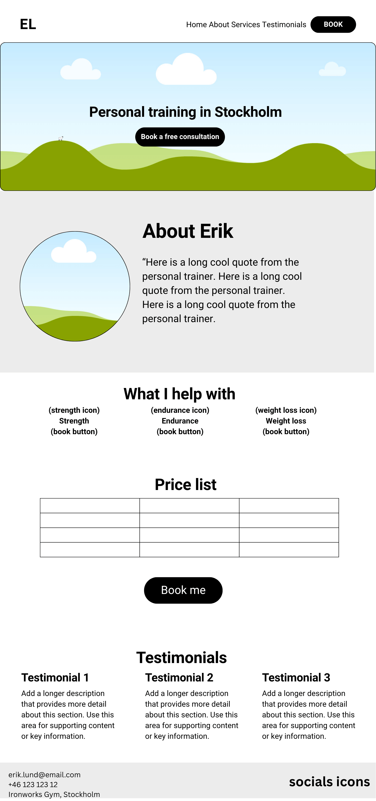
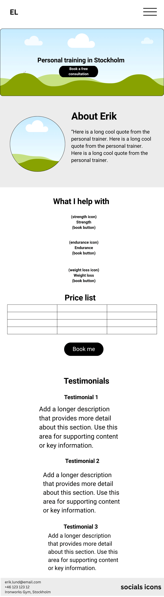
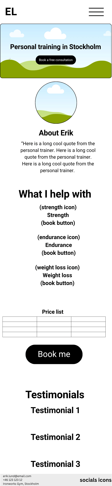
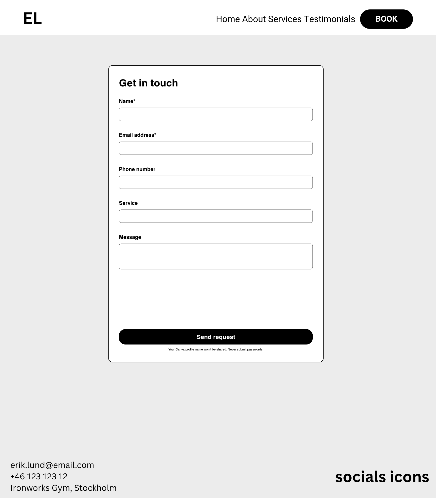
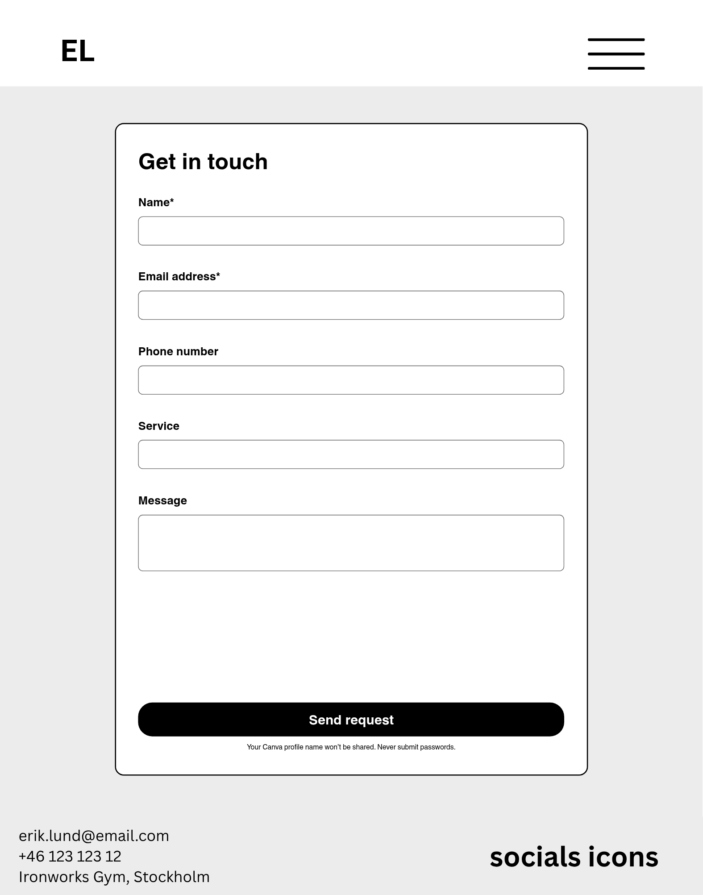
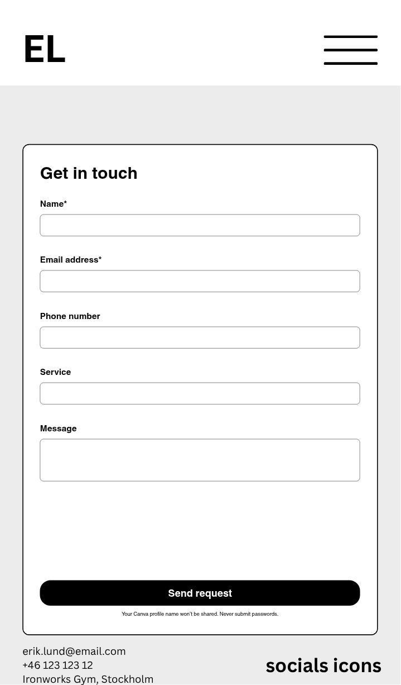
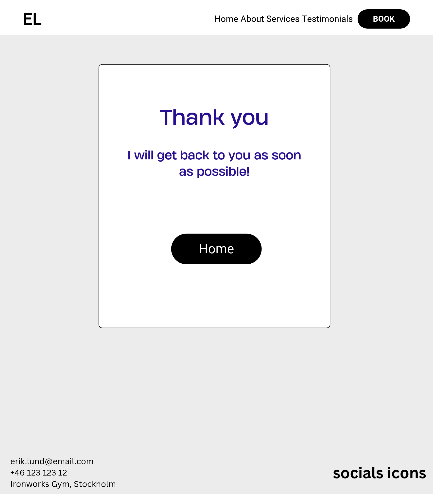
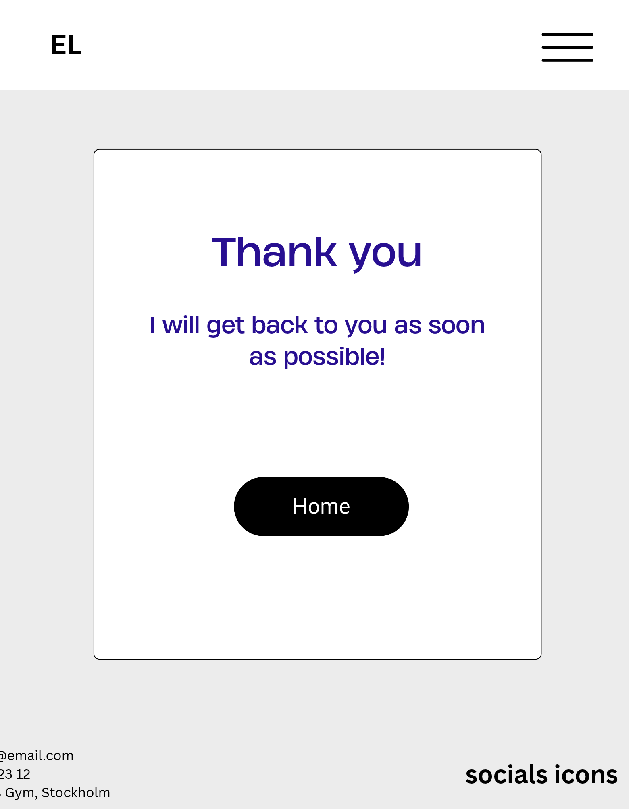
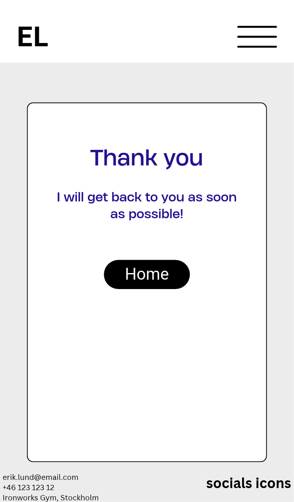

# Erik Lund Personal Training - Milestone Project 1 

## UX

### Strategy
- Business goals
- Target audience
- User goals
- Trade offs
  
### Scope
- Features in scope
- Out of scope (what got dropped)

### Structure
- Map: Home (with sections about, testimonials, services). Booking page -> Thank you page
- Information architectore (IA):
- Interaction design

### Skeleton
Wireframes were created in Canva before coding started. The layout is made for desktop, tablet and mobile for each page.

HOMEPAGE

**Desktop**

**Tablet**

**Mobile**

BOOKING PAGE

**Desktop**

**Tablet**

**Mobile**

THANK YOU PAGE

**Desktop**

**Tablet**

**Mobile**

#### Changes to wireframes
- DONT FORGET to comment on what from the Wireframes ended up not making it.

### Surface
- Colours, contrast
- Font choice
- Images

### User Stories
https://github.com/users/telljacob/projects/7/views/1

## Features

### Existing Features
### Future Features

## Technologies Used

##Development Process

##Testing

## Deployment

## Credits

###Code?
###Content?
###Media (any photographs from somewhere?)
##Acknowledgements
