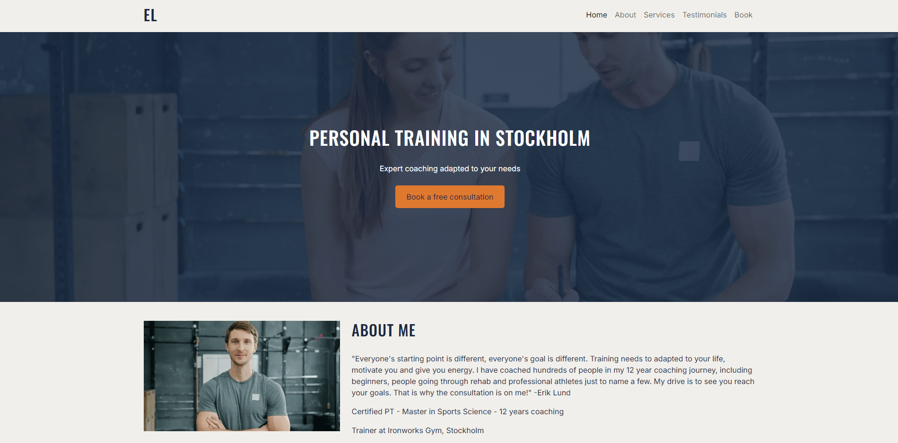
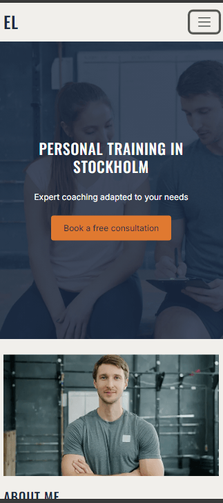
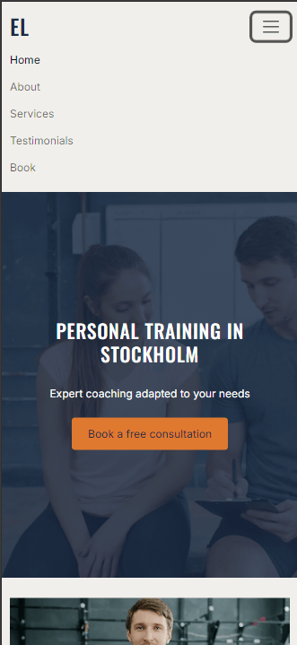
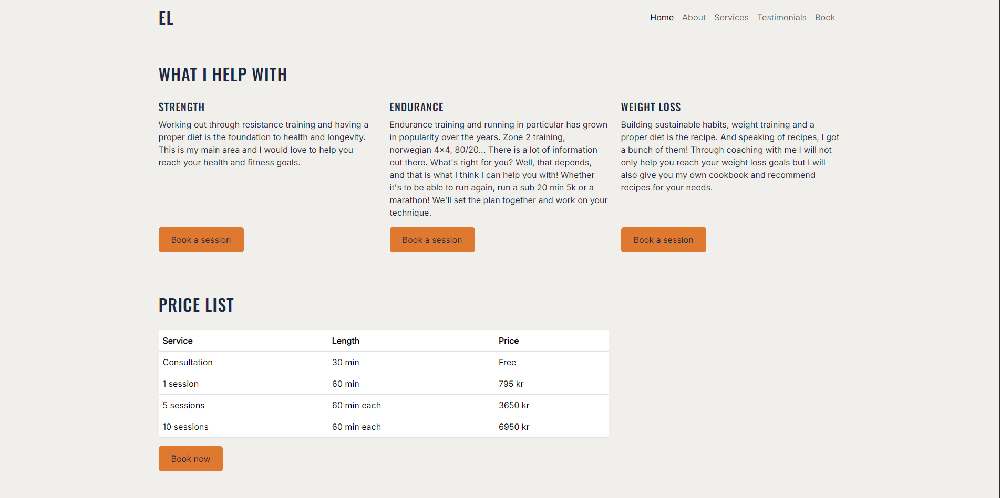
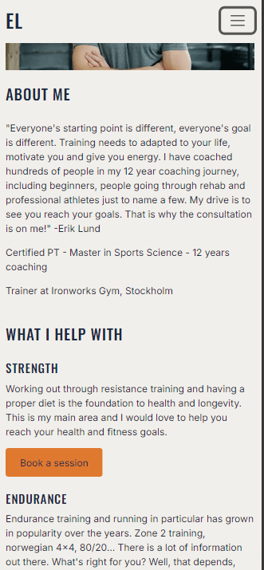
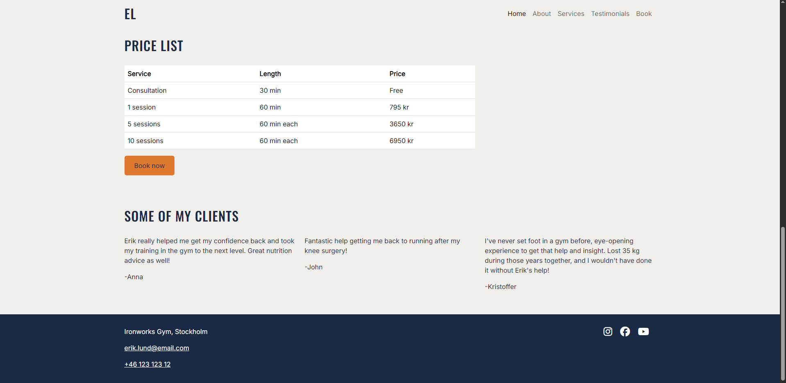
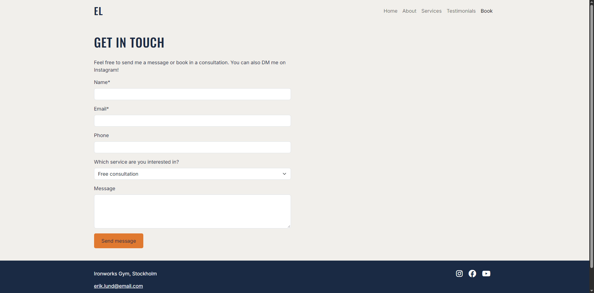
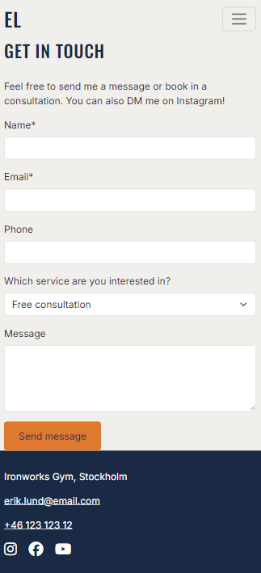
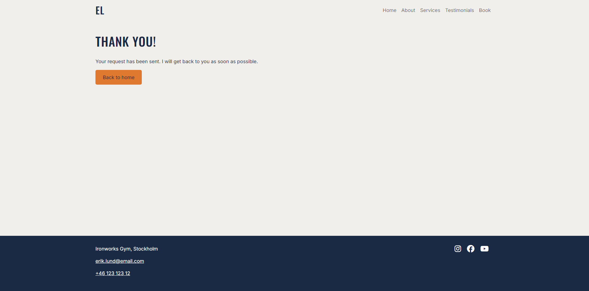
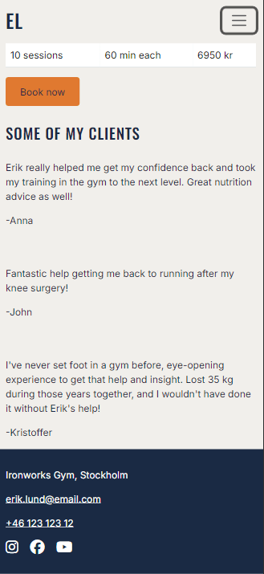

# Erik Lund Personal Training - Milestone Project 1 

A website for Erik Lund (not a real person), a personal trainer in Stockholm. Visitors and potential clients can learn about hi, his different services and his pricing. They can read testimonials and book a free consultation via a simple form. 

[Live site](https://telljacob.github.io/milestone-project-1/)

## UX

### Strategy
#### Business goals
- Get visitors to book a free consultation or buy a paid service.
- Communicate that the coach is a qualified and supportive personal trainer.
- Make prices clear up front.

#### Target audience
**Main audience: beginners and people returning to training**
- Adults who wants some help getting started in the gym, either starting from scratch or coming back from an injury.

**Secondary audience: busy professionals**
- There are many busy professionals in Stockholm and a good portion of them wants to optimize their training with a personal trainer.

#### User goals
- Get a good understanding of Erik, his qualifications and his coaching style.
- That prices are shown up front and not hidden.
- Read about people's experiences with Erik.
- Book a consultation or buy a personal training session.
  
### Scope
- Three pages: Home, Booking and Thank you.
- Home page contains hero, about section, services, price list, testimonials.
- Booking page with a form with validation. No real payment or calendar.

### Future scope
- Advance calendar for booking appointments
- Checkout to pay

### Structure
- Map: Home (with sections about, testimonials, services). 
- Book buttons lead to the booking page.
- Filling out the form on the booking page leads to the thank-you page.
- Navbar and footer is identical on all pages

### Skeleton
Wireframes were created in Canva before coding started. The layout is made for desktop, tablet and mobile for each page.

#### HOMEPAGE

#### BOOKING PAGE

#### THANK YOU PAGE

### Surface
#### Typography
- Oswald for headings and the logo
- Inter for body

#### Color palette

**Combinations and design choices**
The goal was to get a combination that gives a professional and calm impression.
- Navy for the text, headings and footer
- Off-white used as background
- Orange as accent color and in buttons

#### Contrast
Color combinations checked with WebAIM Contrast Checker.

### User Stories
https://github.com/users/telljacob/projects/7/views/1

## Features
### Existing Features

#### Navbar and hero
Sticky navbar on all pages with the "EL" logo. The hero shows what Erik offers and a button to book a free consultation.

On mobile the navbar collapses into a hamburger menu, which closes when a link is clicked.

#### About, services and price list
About presents Erik's background and qualifications. Services shows strength, endurance and weight loss, each with a booking button. The price list makes prices clear before booking.

#### Testimonials
Short quotes from clients that build trust.

#### Booking form
Name and email are required, the email format is checked, and the phone field only accepts numbers, spaces, + and -.

#### Thank-you page
Confirms that the request was sent and links back to the home page.

#### Footer
Contact details and social links that open in a new tab, on all pages.

### Future Features
- Online payment and calendar booking.
- A separate page for each service.

### Existing Features
### Future Features
- Payment and booking via calendar.

## Technologies Used
### Languages
- HTML5
- CSS3

### Tools
- [Canva](https://www.canva.com/)
- [Coolors](https://coolors.co/)
- [WebAIM Contrast Checker](https://webaim.org/resources/contrastchecker/)
- [TinyPNG](https://tinypng.com/)

## Development Process

## Testing
### Validators
- HTML: no errors on all three pages. Check via (https://validator.w3.org/)
- CSS: no errors. Check via (https://jigsaw.w3.org/css-validator/)

- Choosing a color palette was done by trial and error in Coolors.
- Testing of color contrast done in WebAIM checker.
 
### Bugs fixed
- Favicon didn't show → folder name didn't match the link path.
- Footer floated mid-page on the thank-you page. Fixed with flexbox 'min-vh-100'.

## Credits
### Code
- Bootstrap 5.3 - copied grid, navbar and form (navbar and form adapted but used the standard to start off)
- Font Awesome - social icons.
- Google Fonts - Oswald and Inter

### Media
- Hero image and portrait by Vitaly Gariev on Unsplash.
- Portrait of Erik by Vitaly Gariev on Unsplash
- Favicon generated with favicon.io