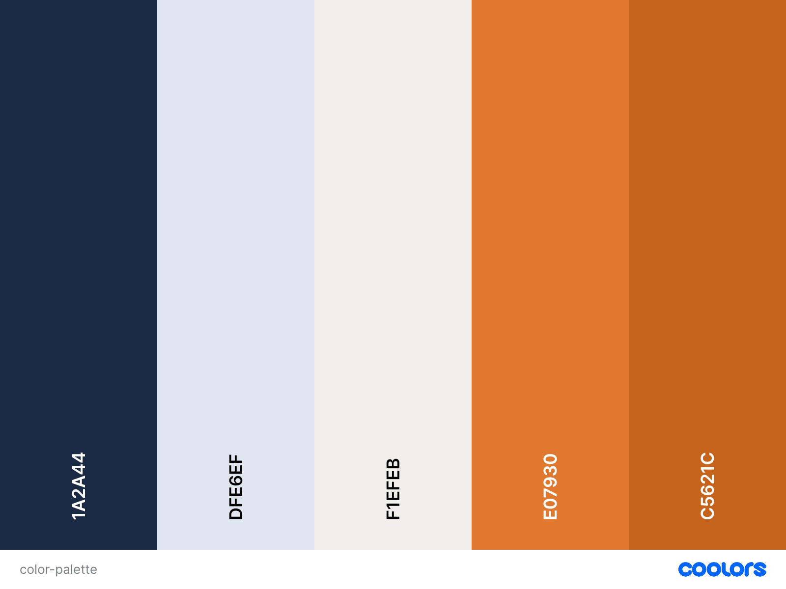
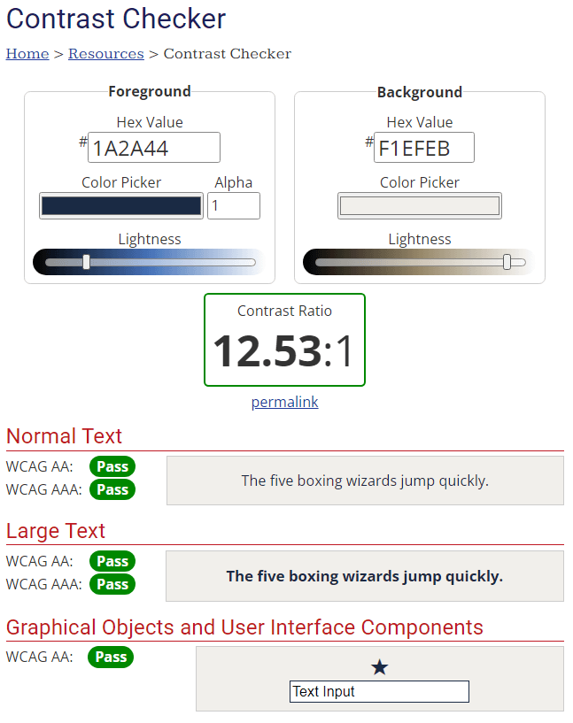
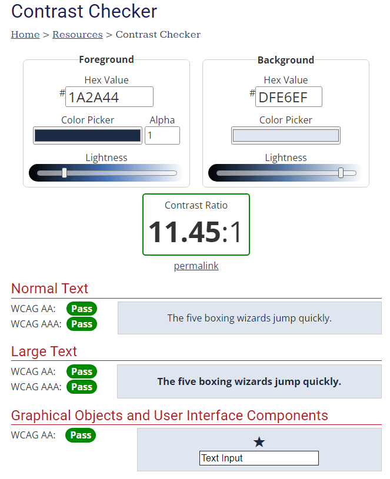
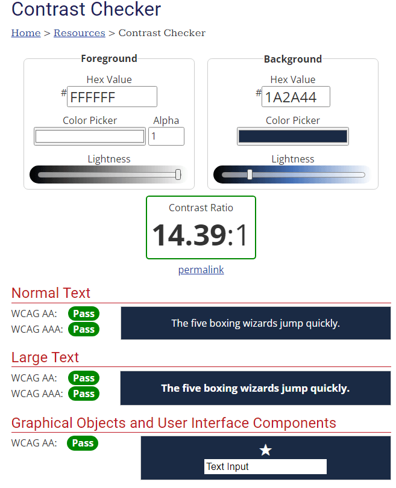
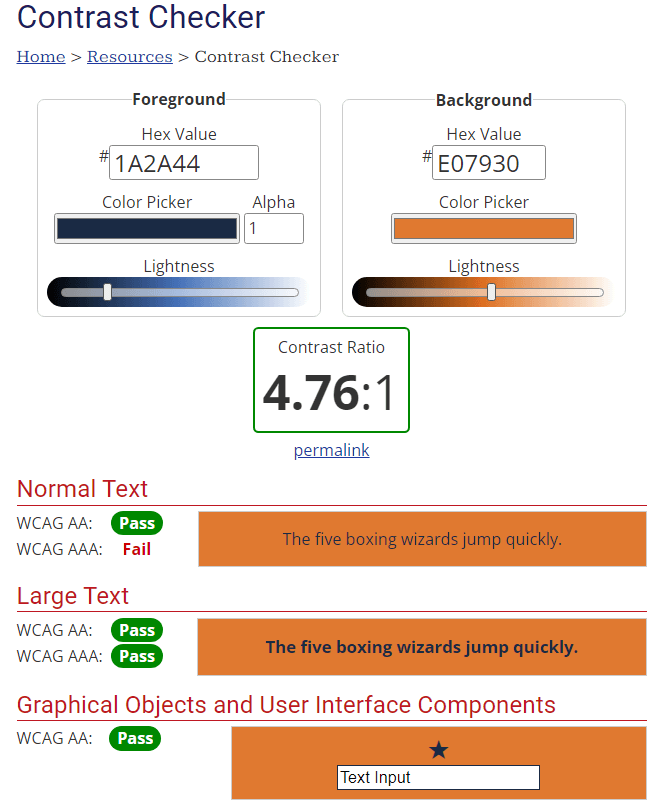
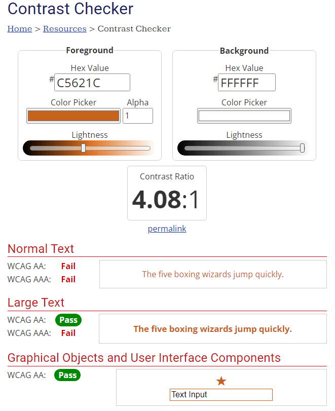

# Erik Lund Personal Training - Milestone Project 1 

## UX

### Strategy
#### Business goals
- Get visitors to book a free consultation or buy a paid service.
- Communicate that the coach is a qualified and supportive personal trainer.
- Make prices clear up front.

#### Target audience
**Main audience: beginners and people returning to training**
- Adults who wants some help getting started in the gym, either starting from scratch or coming back from an injury.

**Secondary audience: busy professionals**
- There are many busy professionals in Stockholm and a good portion of them wants to optimize their training with a personal trainer.

#### User goals
- Get a good understanding of Erik, his qualifications and his coaching style.
- That prices are shown up front and not hidden.
- Read about people's experiences with Erik.
- Book a consultation or buy a personal training session.
  
### Scope
- Features in scope
- Out of scope (what got dropped)

### Structure
- Map: Home (with sections about, testimonials, services). Booking page -> Thank you page
- Information architectore (IA):
- Interaction design

### Skeleton
Wireframes were created in Canva before coding started. The layout is made for desktop, tablet and mobile for each page.

#### HOMEPAGE

#### BOOKING PAGE

#### THANK YOU PAGE

#### Changes to wireframes
- DONT FORGET to comment on what from the Wireframes ended up not making it.

### Surface
Left to add
- Images

#### Typography
Fonts chosen and imported from Google Fonts.

- Oswald as main and Inter as fallback

#### Color palette

**REMEMBER TO ADD: Combinations and design choices**

The goal was to get a combination that gives a professional and calm impression.

#### Contrast

Color combinations checked with WebAIM Contrast Checker.

### User Stories
https://github.com/users/telljacob/projects/7/views/1

## Features

### Existing Features
### Future Features

## Technologies Used
### Languages
- HTML5
- CSS3

### Tools
- [Canva](https://www.canva.com/)
- [Coolors](https://coolors.co/)
- [WebAIM Contrast Checker](https://webaim.org/resources/contrastchecker/)
- [TinyPNG](https://tinypng.com/)

## Development Process

## Testing
- Choosing a color palette was done by trial and error in Coolors.
- Testing of color contrast done in WebAIM checker.
 

## Deployment

## Credits
Hero image by Vitaly Gariev on Unsplash
Portrait of Erik by Vitaly Gariev on Unsplash

### Code?
### Content?
### Media (any photographs from somewhere?)
## Acknowledgements
